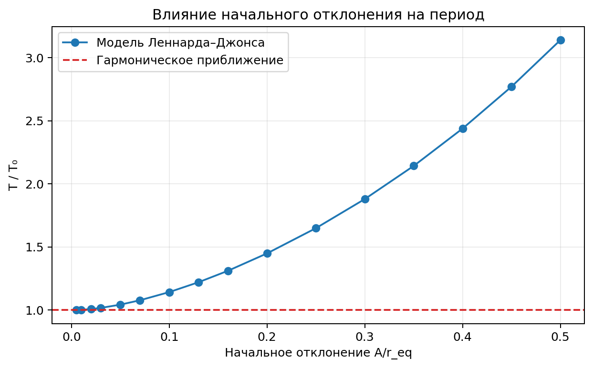
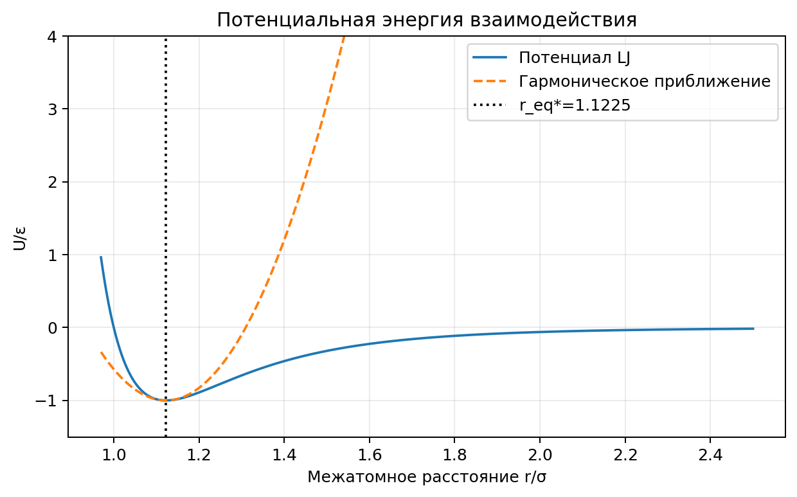
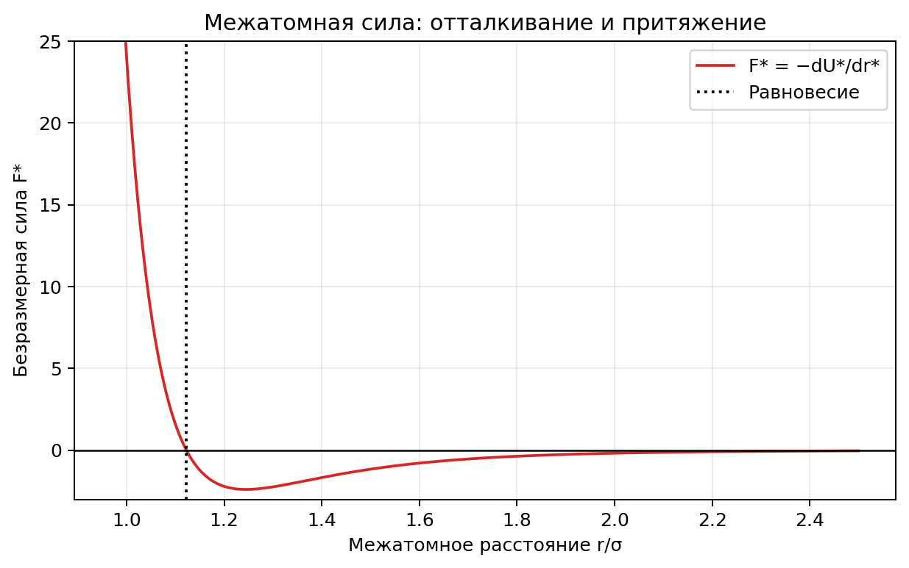
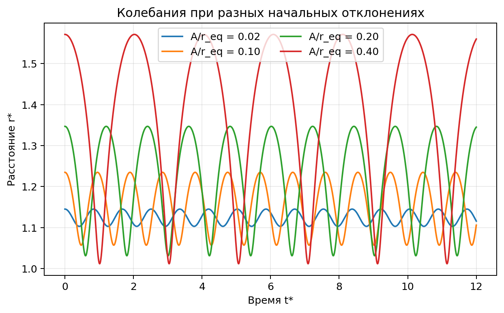
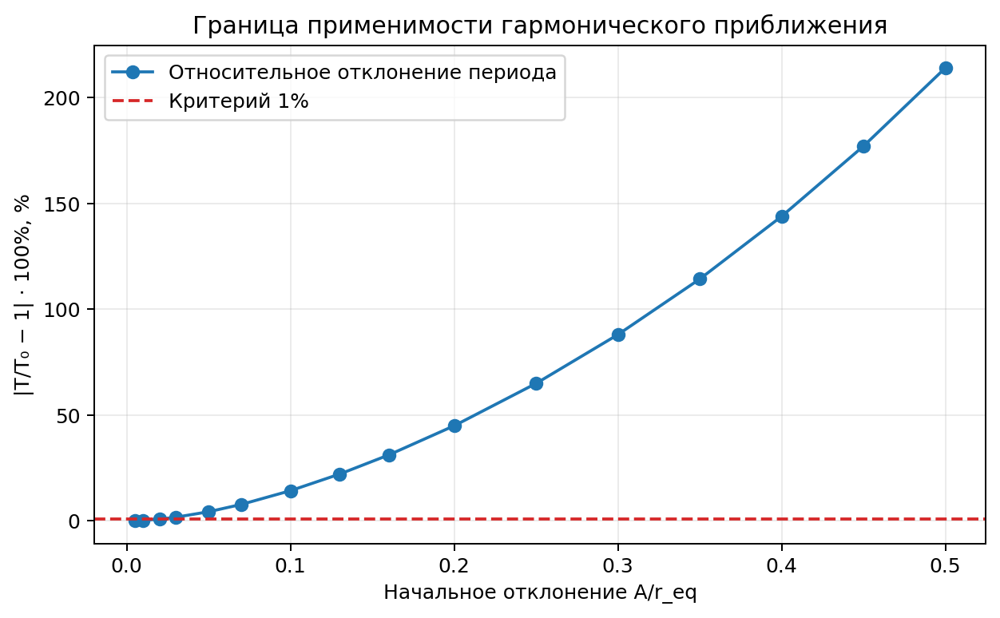
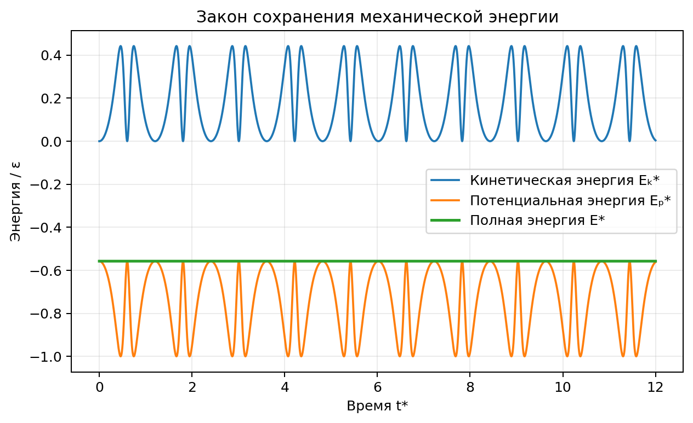
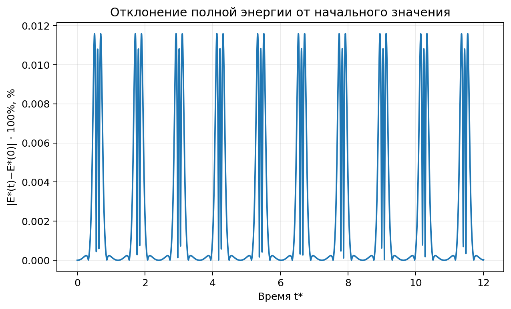
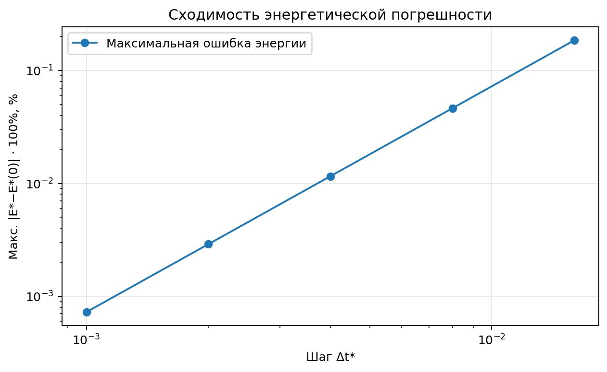
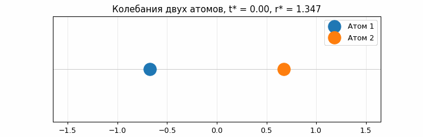

# Динамика двух атомов: потенциал Леннарда — Джонса

Программа моделирует одномерное относительное движение двух одинаковых атомов в парном потенциале Леннарда — Джонса. Основная задача — исследовать зависимость периода колебаний от начального отклонения и сравнить нелинейное движение с гармоническим приближением. Уравнение движения интегрируется позиционным методом Верле из материалов лекции по компьютерному моделированию.



## Физическая постановка

Рассматриваются два одинаковых нейтральных атома (например, аргона). Их взаимодействие описывается эффективным парным потенциалом. При большом расстоянии преобладает притяжение, при малом — отталкивание. В окрестности устойчивого равновесия атомы совершают колебания.

Приняты следующие допущения:

- атомы рассматриваются как материальные точки равной массы;
- движение происходит вдоль одной прямой, относительный момент импульса равен нулю;
- центр масс неподвижен, внешние силы и диссипация отсутствуют;
- используется классическая механика, электронная структура и квантовые уровни не вычисляются;
- межатомное взаимодействие задаётся потенциалом Леннарда — Джонса 12–6;
- начальная относительная скорость равна нулю, а начальное расстояние больше равновесного.

Это модель **изолированной пары атомов**, а не газа, кристалла или реального процесса разрушения материала.

## Математическая модель

### Потенциальная энергия и сила

Для атомов с радиус-векторами $\mathbf r_i$ и $\mathbf r_j$:

$$
U_{ij}=4\varepsilon\left[\left(\frac{\sigma}{|\mathbf r_j-\mathbf r_i|}\right)^{12}-\left(\frac{\sigma}{|\mathbf r_j-\mathbf r_i|}\right)^6\right].
$$

Здесь $\varepsilon$ — глубина потенциальной ямы, $\sigma$ — масштаб расстояния; межатомное расстояние $r=|\mathbf r_j-\mathbf r_i|$. Член $r^{-12}$ моделирует короткодействующее отталкивание, член $-r^{-6}$ — дисперсионное притяжение.

Сила в координате увеличения межатомного расстояния равна:

$$
F(r)=-\frac{dU}{dr}=\frac{24\varepsilon}{r}\left[2\left(\frac{\sigma}{r}\right)^{12}-\left(\frac{\sigma}{r}\right)^6\right].
$$

Условие равновесия $F(r_{\mathrm{eq}})=0$ даёт:

$$
r_{\mathrm{eq}}=2^{1/6}\sigma,\qquad U(r_{\mathrm{eq}})=-\varepsilon.
$$





### Относительное движение

Для масс $m_1=m_2=m$ приведённая масса $\mu=m/2$. Уравнение движения:

$$
\mu\ddot r=F(r), \qquad E=\frac{\mu\dot r^2}{2}+U(r)=\mathrm{const}.
$$

Начальные условия задаются относительным отклонением $a=A/r_{\mathrm{eq}}$:

$$
r(0)=r_{\mathrm{eq}}(1+a),\qquad \dot r(0)=0.
$$

Здесь $A$ — отклонение начального расстояния в сторону увеличения; из-за несимметричности потенциала оно не равно половине полного размаха нелинейного колебания.

### Гармоническое приближение

При небольшом $|r-r_{\mathrm{eq}}|$ потенциал приближённо квадратичен:

$$
U_{\mathrm{harm}}(r)=-\varepsilon+\frac{k}{2}(r-r_{\mathrm{eq}})^2,
\qquad k=U''(r_{\mathrm{eq}})=\frac{72\varepsilon}{r_{\mathrm{eq}}^2}.
$$

Теоретический период малых колебаний:

$$
T_0=2\pi\sqrt{\frac{\mu}{k}}=2\pi\sqrt{\frac{\mu r_{\mathrm{eq}}^2}{72\varepsilon}}.
$$

Для гармонического осциллятора период не зависит от амплитуды. Для исходного нелинейного потенциала он изменяется с увеличением $A$.

### Безразмерные величины

Для устойчивой и удобной численной работы используются масштабы:

$$
\tau=\sigma\sqrt{\frac{\mu}{\varepsilon}},\qquad
r^{*}=\frac{r}{\sigma},\quad t^{*}=\frac{t}{\tau},\quad U^{*}=\frac{U}{\varepsilon}.
$$

Тогда уравнение движения и энергия имеют вид:

$$
\frac{d^{2}r^{*}}{d(t^{*})^{2}}=24\left[2(r^{*})^{-13}-(r^{*})^{-7}\right],
$$

$$
E^{*}=\frac{1}{2}\left(\frac{dr^{*}}{dt^{*}}\right)^2+4\left[(r^{*})^{-12}-(r^{*})^{-6}\right].
$$

В этих единицах $r_{\mathrm{eq}}^{*}=2^{1/6}\approx1.122462$ и $T_0^{*}\approx0.831161$. Численная функция `force(r)` возвращает безразмерное ускорение относительной координаты.

## Численное интегрирование

Применяется **позиционный метод Верле**, приведённый в материалах лекции:

$$
r_{n+1}=2r_n-r_{n-1}+a(r_n)\Delta t^2,
\qquad v_n=\frac{r_{n+1}-r_{n-1}}{2\Delta t}.
$$

Здесь $a(r_n)$ — ускорение, не параметр начального отклонения $a=A/r_{\mathrm{eq}}$; в формулах эти понятия различаются аргументом. Первый шаг вычисляется из начальной координаты и ускорения:

$$
r_1=r_{\mathrm{init}}+v_{\mathrm{init}}\Delta t+\frac{1}{2}a(r_{\mathrm{init}})\Delta t^2,
\qquad v_{\mathrm{init}}=0.
$$

На концах массива скорости вычисляются односторонними разностями второго порядка. Глобальный порядок сходимости схемы по координате — второй; локальный остаток $O(\Delta t^4)$ в позиционной формуле не означает четвёртый глобальный порядок.

Время максимумов $r(t)$ уточняется параболической интерполяцией по трём соседним точкам. Период оценивается средним интервалом между последовательными максимумами.

## Запуск

Требуются Python 3.10+ и библиотеки NumPy, Matplotlib и Pillow:

```bash
python -m pip install numpy matplotlib pillow
python LJ_lab.py
```

Программа не открывает графические окна: изображения, таблицы и анимация записываются в `results/` рядом с файлом `LJ_lab.py`. При повторном запуске файлы с теми же именами заменяются.

## Настройки

Все пользовательские параметры расположены в начале `LJ_lab.py` и записаны в стиле `snake_case`.

| Параметр | Исходное значение | Назначение |
|---|---:|---|
| `out_dir` | `results/` | Каталог выходных файлов |
| `dt` | `0.004` | Безразмерный шаг времени для основного эксперимента |
| `t_end_sweep` | `60.0` | Продолжительность расчёта при каждом отклонении |
| `amplitudes` | 16 значений от `0.005` до `0.50` | Набор значений $a=A/r_{\mathrm{eq}}$ |
| `a_example` | `0.20` | Отклонение для энергетических графиков, анимации и проверки сходимости |
| `max_time_plot` | `12.0` | Конец временного интервала на основных графиках |
| `dt_steps` | `[0.016, 0.008, 0.004, 0.002, 0.001]` | Шаги для исследования сходимости |
| `error_tol_pct` | `1.0` | Допустимое расхождение с гармоническим периодом, % |
| `create_gif` | `True` | Сохранять ли анимацию |
| `gif_frames` | `90` | Число кадров анимации |
| `gif_fps` | `18` | Частота кадров GIF |

Например, для уточнения порога применимости гармонического приближения можно установить:

```python
amplitudes = np.array([0.01, 0.015, 0.02, 0.022, 0.024, 0.026, 0.03])
```

Для уменьшения погрешности интегрирования можно уменьшить `dt` до `0.002`; время выполнения при этом увеличится. Для запуска без анимации установите `create_gif = False`. Если изменяется `a_example`, то обновляются графики энергии, анимация, тест сходимости и одна из кривых графика колебаний.

**Ограничения настроек.** Требуются положительные `dt` и длительность моделирования, положительные межатомные расстояния. Для предусмотренного эксперимента следует использовать неотрицательные амплитуды. При слишком большом шаге возможна численная неустойчивость; при слишком коротком расчёте программа не найдёт достаточно максимумов для определения периода. Полная автоматическая проверка всех параметров не реализована.

## Вычислительные эксперименты

### 1. Потенциал и равновесие

Строятся $U^{*}(r^{*})$ и $F^{*}(r^{*})$. Положение нулевой силы сравнивается с аналитическим $r_{\mathrm{eq}}^{*}$.

### 2. Период нелинейных колебаний

Для каждого значения $A/r_{\mathrm{eq}}$ определяется период $T^{*}$ и относительное отклонение от гармонического значения:

$$
\delta_T=100\left|\frac{T}{T_0}-1\right|\,\%.
$$






При выбранном критерии $\delta_T\le1\%$ последняя проверенная амплитуда, удовлетворяющая ограничению в исходной сетке, равна $A/r_{\mathrm{eq}}=0.02$. Точный порог находится между `0.02` и `0.03` и без дополнительного сгущения сетки не определяется.

### 3. Энергия и сходимость

Для одного фиксированного начального отклонения записываются кинетическая $E_k^{*}$, потенциальная $E_p^{*}$ и полная $E^{*}$ энергии. Энергетическая диагностика нормируется на глубину потенциальной ямы:

$$
\delta_E(t^{*})=100\left|E^{*}(t^{*})-E^{*}(0)\right|\,\%.
$$





При уменьшении $\Delta t^{*}$ приблизительно вдвое максимальное отклонение энергии уменьшается примерно в четыре раза, что согласуется со вторым порядком точности используемой схемы.



### Анимация

В системе центра масс положения одинаковых атомов отображаются как $x_1=-r/2$ и $x_2=r/2$.



## Выходные данные

| Файл | Содержимое |
|---|---|
| `output1.png` | Потенциал и гармоническая аппроксимация |
| `output2.png` | Сила взаимодействия |
| `output3.png` | Расстояние между атомами во времени для разных отклонений |
| `output4.png` | Отношение $T/T_0$ в зависимости от $A/r_{\mathrm{eq}}$ |
| `output5.png` | Отклонение периода от гармонического и критерий 1% |
| `output6.png` | Энергетический баланс |
| `output7.png` | Изменение полной энергии |
| `output8.png` | Сходимость энергетической погрешности |
| `animation.gif` | Движение атомов в системе центра масс |
| `period_sweep.csv` | Таблица по амплитудам |
| `time_step_convergence.csv` | Таблица по временным шагам |
| `summary.txt` | Сводка параметров расчёта |

CSV-файлы имеют разделитель `;` и кодировку UTF-8 с BOM для удобства открытия в Excel. Десятичный разделитель в числах — точка.

**`period_sweep.csv`:** `A_over_r_eq` — $A/r_{\mathrm{eq}}$; `T_reduced` — $T^{*}$; `T_over_T0` — $T/T_0$; `harmonic_error_percent` — $\delta_T$; `period_std` — выборочное стандартное отклонение интервалов между максимумами одного расчёта; `n_periods` — число таких интервалов; `max_energy_error_percent` — максимальное $\delta_E$.

**`time_step_convergence.csv`:** `dt` — $\Delta t^{*}$; `max_energy_error_percent` — максимальное $\delta_E$; `period_reduced` — $T^{*}$; `deviation_from_harmonic_percent` — отклонение от *гармонической* модели, а не ошибка относительно точного нелинейного решения.

## Проверка результатов и ограничения

Для исходных настроек программа воспроизводит следующие аналитические значения:

$$
r_{\mathrm{eq}}^{*}=1.12246204831,\qquad T_0^{*}=0.831161247194,\qquad U^{*}(r_{\mathrm{eq}}^{*})=-1.
$$

| $A/r_{\mathrm{eq}}$ | Численный $T^{*}$ | $\delta_T$, % |
|---:|---:|---:|
| 0.02 | 0.83779020 | 0.79755 |
| 0.03 | 0.84531062 | 1.70236 |
| 0.10 | 0.94950868 | 14.23880 |
| 0.20 | 1.20437480 | 44.90266 |
| 0.50 | 2.60912863 | 213.91365 |

Для $A/r_{\mathrm{eq}}=0.20$:

| $\Delta t^{*}$ | Максимальное $\delta_E$, % |
|---:|---:|
| 0.016 | 0.185824 |
| 0.008 | 0.046376 |
| 0.004 | 0.011589 |
| 0.002 | 0.002897 |
| 0.001 | 0.000724 |

**Верификация:** проверяются аналитические свойства равновесия, сохранение энергии и сходимость численного расчёта. Отдельное сравнение с высокоточным интегрированием показывает согласие периодов в пределах примерно `0.004%` для контрольных амплитуд `0.02`, `0.20` и `0.50`.

**Валидация:** экспериментальное подтверждение модели для реальных атомов аргона в эту работу не входит. Согласие программы с аналитическими свойствами используемого потенциала не является независимой физической валидацией.

При интерпретации результатов необходимо учитывать:

- отличие $T$ от $T_0$ при больших амплитудах — эффект нелинейности, а не ошибка интегратора;
- периодические пики энергетической ошибки допустимы для схемы Верле и использованного способа восстановления скорости;
- гармоническая парабола на `output1.png` показана далеко от минимума только для сравнения и там уже неприменима;
- `period_std` не является доверительным интервалом, поскольку модель детерминированная;
- абсолютная ошибка энергии нормирована на $\varepsilon$, а не на $|E(0)|$;
- безразмерное время $t^{*}$ не измеряется в секундах.

### Пример перехода к физическим единицам аргона

В скрипте приведены ориентировочные параметры: $\sigma=3.405\cdot10^{-10}\,\text{м}$, $\varepsilon/k_B=119.8\,\text{К}$, $m=39.948\,u$, $\mu=m/2$. Они не влияют на основной безразмерный расчёт. Переход к времени в секундах выполняется по $t=\tau t^{*}$, где $\tau=\sigma\sqrt{\mu/\varepsilon}$.

## Структура программы

`potential()` и `force()` вычисляют потенциал и силу; `harmonic_potential()` — квадратичную аппроксимацию; `simulate()` интегрирует относительное движение. Функции `turning_max_times()` и `measured_period()` определяют период, `energy_error_pct()` рассчитывает энергетическое отклонение, `make_animation()` записывает GIF, а `main()` запускает эксперименты и сохраняет файлы.

## Источники

1. Федулов В. А. *Компьютерное моделирование. Лекция № 6 «Методы динамики частиц»*. МГТУ им. Н. Э. Баумана, 2026.
